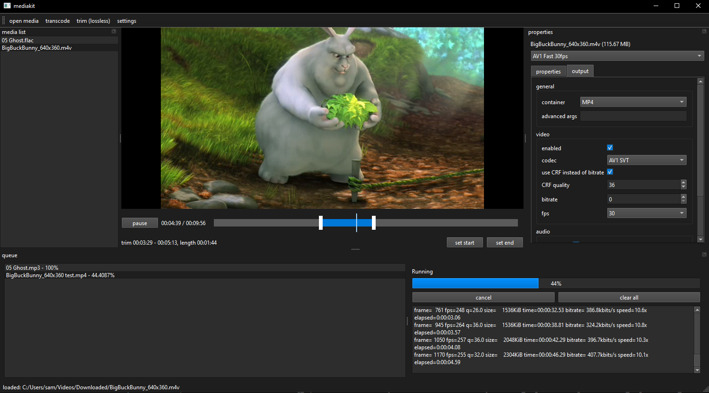

# mediakit
mediakit is a media converter built on top of ffmpeg. it is meant to trim media, transcode it, transform media (such as audio/video/image) and things of that nature.

[usage](./docs/USAGE.md) | [releases](https://github.com/samxyz30/mediakit/releases)




## build
requires Qt6 widgets and multimedia libraries

build is just regular cmake workflow:

```sh
cmake -S . -B build -DCMAKE_BUILD_TYPE=Release
cmake --build build
```

install
```sh
cmake --install build --prefix dist
```


## roadmap
- basics
  - [x] video playback/seeking via QMediaPlayer
  - [x] basic trim markers
  - [x] basic video trimming
  - [x] basic job queue/system, calling and parsing ffmpeg outputs
  - [x] better trim timeline
    - [x] (PARTIAL) zoom in/out on the timeline for big videos
  - [x] media list dock, imports and drag and drop
  - [x] properties dock, likely a tree or something of options to change for selected media
  - [x] bundle ffmpeg some way
- properties
  - [x] more than just trimming
  - [x] get info about media
  - [x] choose target output containers
  - [x] choose target codecs
  - [x] choose target bitrate etc...
  - [ ] other tools like extract video to audio, common things like this

...and many more. just grep for `TODO` in the codebase to find out for yourself.

## license
GPLv3. read LICENSE for more information.


mediakit Copyright (C) 2026 

This program is free software: you can redistribute it and/or modify it under the terms of the GNU General Public License as published by the Free Software Foundation, either version 3 of the License, or (at your option) any later version.

This program is distributed in the hope that it will be useful, but WITHOUT ANY WARRANTY; without even the implied warranty of MERCHANTABILITY or FITNESS FOR A PARTICULAR PURPOSE. See the GNU General Public License for more details.

You should have received a copy of the GNU General Public License along with this program. If not, see <https://www.gnu.org/licenses/>.
